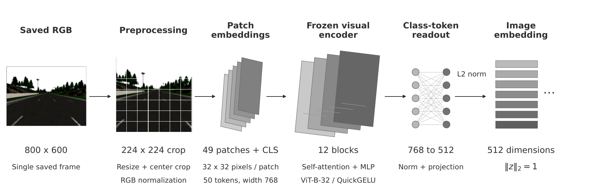

# Dataset and characterization figures

The [dataset illustrations](https://huggingface.co/datasets/checo1092/egospatial-cl/blob/main/docs/figures.md) show weather/traffic and trajectories by split. Their PNG/PDF assets and frame identifiers are hosted with the dataset. The scripts here read extracted episodes without modifying them. Use Python 3.10+ and install `examples/publication_figures/requirements.txt`.

```bash
python examples/publication_figures/plot_weather_traffic.py --dataset-root /path/to/extracted --selection /path/to/weather_traffic_frames.json --output /path/to/figures
python examples/publication_figures/plot_trajectories_by_split.py --dataset-root /path/to/extracted --manifest /path/to/dataset_manifest.json --output /path/to/figures
```

Download `docs/assets/weather_traffic_frames.json` from the dataset repository. The route plot reads 140 state CSVs, and the mosaic reads eight RGB frames. Both scripts accept the public town/split/episode layout and the original town/episode layout.

## CLIP characterization pipeline



[Vector PDF](assets/clip_architecture.pdf). The diagram depicts the image branch used for distribution characterization: 224-pixel input, 32-pixel patches and a 512-dimensional embedding. Planes and token stacks are schematic, not activations. Reproduce it from Town06/val/episode_0008/images/083529.png:

```bash
python examples/publication_figures/build_clip_architecture.py --image /path/to/extracted/Town06/val/episode_0008/images/083529.png --output /path/to/figures
```

Dataset images embedded in the figures remain under CC BY 4.0; accompanying code is MIT-licensed.
